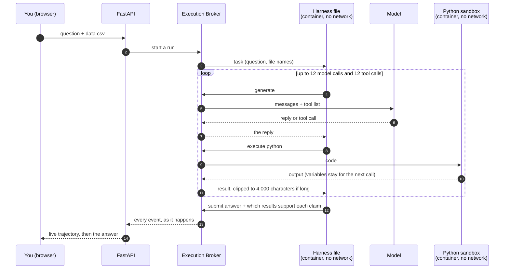
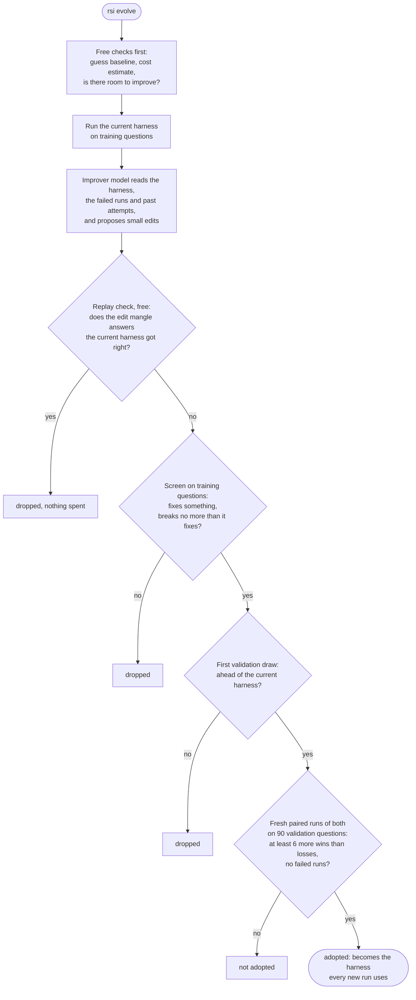

# RSI

A science assistant whose own control program can be rewritten, tested and replaced.

You ask a question about a data file. A small model works through it with tools while a host process watches every step. Separately, a loop asks a stronger model to edit the program that drives the small model, and keeps an edit only if it wins a paired test on held-out questions.

It is a personal rebuild of the idea behind [ScienceBuddy](https://github.com/Gen-Verse/ScienceBuddy), sized for one person and a few dollars per experiment.

<picture>
  <source media="(prefers-color-scheme: dark)" srcset="docs/img/system-dark.svg">
  
</picture>

## The three ideas

**1. The harness is one small file.** A harness is the program that sits between a model and a task: it decides what to ask the model, which tool calls to run, and when to stop. Here it is about a hundred lines of Python exporting `run(task, api)`. Because it is one file, a model can read all of it and change it.

**2. The harness is never trusted.** It runs in a container with no network and no keys. It cannot call a model or a tool itself. It can only ask the host, the Execution Broker, which enforces the limits and writes everything down. This matters because harness files are written by a model.

**3. A new harness has to earn its place.** A rewritten harness replaces the current one only after it beats it on questions neither has been tuned on, by a margin chosen so that luck rarely passes.

## One question, start to finish



Each arrow that touches the broker becomes a line in `events.jsonl`. Nothing reaches the model, a tool or you without passing through it.

### What the broker guarantees, whatever the harness does

| Guarantee | How |
|---|---|
| A run cannot go on forever | 12 model calls, 12 tool calls, 60 seconds per tool, 600 seconds per run, including calls in flight |
| Nothing is hidden | Long tool output is shown clipped, marked as clipped, and saved in full |
| The answer key stays out of reach | A task's reference answer never leaves the host process |
| Nothing is left running | However a run ends, both containers are removed and a record is written |
| Sandbox code cannot fake a result | The code runs in a child process that cannot reach the channel the host reads, and every reply must carry the id of its request |

## How a harness gets replaced



Why the last step is so strict: the same harness on the same question gives a different result about one time in six. With that much noise, a simple "beat the current one twice" rule adopted a no-effect edit 39% of the time in simulation. The paired rule with a margin of six brings that down to about 6%, and still adopts a real ten-point improvement about 81% of the time. The price is that small real gains are usually turned away.

A third of the benchmark questions are a test pool that this loop never reads. It exists for one job: checking, at the end, whether an adopted harness is better on questions nothing was tuned on.

## What has been measured

All with a small task model (`gpt-5-mini`), one run per question, graded by code. No model grades anything.

| Question | Result |
|---|---|
| Do the tools matter? | On a 40-question sample of [DABench](https://github.com/InfiAgent/InfiAgent) the full system answers 72.5% (95% interval 57 to 84). The same model with no tools answers 0%. |
| Does it transfer? | On a 40-question sample of [QRData](https://github.com/xxxiaol/QRData) it answers 57.5%, against 22.5% for a constant guess. |
| Did the first evolve run help? | No. Three rewrites, all worse than the original. Each included the same unrelated "cleanup" that deleted bracketed numbers from correct answers. |
| Has any edit been adopted? | One. Reading the failures showed the model often paged through the CSV as text and never opened Python. A harness that tells it to load the file with pandas, and nudges it after two page reads, scored 91% and 87% on two sets of 45 validation questions against 80% and 76% for the original: 11 wins and 1 loss over the 90 paired questions. That edit was written by hand. The improver model has not yet produced a winner. |
| Did asking a fast judge model to vet answers help? | No. It sent back right answers about as often as wrong ones, so it is off by default. |
| Where were points lost? | Of 24 failed runs read by hand, 10 paged through the CSV as text and never opened Python. Two more failed because the sandbox was missing scikit-learn, which was a setup mistake and is fixed. |
| How noisy is a comparison? | Repeating a run flips the outcome 18% of the time. Detecting a ten-point gain reliably needs about 220 questions. |

Things to keep in mind when reading these numbers:

- The samples are small and the intervals are wide.
- DABench's answer labels were first produced by a model and then checked by people. A few look wrong.
- The sandbox image and the graders changed during the day these were taken, so earlier and later runs are not strictly comparable.
- The one adopted harness was decided under an earlier, weaker version of the adoption rule. Its margin would also clear the current rule, but it has not yet been checked on the reserved test pool.

## Run it

You need Docker, [uv](https://docs.astral.sh/uv/), Node 20 or newer, and a model provider key.

```bash
uv sync
docker build -t rsi-sandbox sandbox/
cp .env.example .env            # set RSI_MODEL, RSI_IMPROVER_MODEL and your provider key
uv run rsi serve                # API on 127.0.0.1:8000
cd web && npm install && npm run dev    # UI on localhost:3000
```

From the terminal:

```bash
uv run rsi run "Which arm is higher, and is it significant?" --file data.csv
uv run rsi eval --family generated --n 40 --conditions null      # free, needs no key
uv run rsi eval --family dabench --n 40 --conditions null,no_tools,full --budget 5
uv run rsi evolve --family dabench --budget 8                    # one generation (worst case about 520 runs)
uv run rsi compare --family dabench --a harnesses/000.py --b harnesses/001.py   # without --b it scores one harness
uv run pytest tests/test_e2e.py -q                               # the whole path, no paid calls
```

Every command that spends money prints a cost estimate first and stops at `--budget`.

The benchmark files are not in this repository. Put a copy of each benchmark's data under `evals/src/dabench` and `evals/src/qrdata`, or point `RSI_DABENCH_SRC` and `RSI_QRDATA_SRC` at them.

## Where things are

| Path | What it is |
|---|---|
| `rsi/harness.py` | The seed harness. Start here: it is the file everything else exists to run and improve. |
| `rsi/broker.py`, `rsi/transport.py` | The Execution Broker: one run, its limits, its log. |
| `rsi/runner.py` | The few lines that run inside the harness container and hand the harness its `api`. |
| `rsi/tools.py`, `rsi/pyloop.py` | The two tools, `python` and `read_file`, and the Python interpreter that keeps its state for a whole run. |
| `rsi/llm.py`, `rsi/jev.py` | Model calls through litellm; the optional fast judge. |
| `rsi/grading.py`, `rsi/tasks.py` | Graders, and a generator of small data questions with known answers. |
| `rsi/evals.py` | Benchmarks, conditions, and reports that are recomputed from the raw run files. |
| `rsi/evolve.py`, `rsi/improver.py` | The evolve loop and what the improver model is shown. |
| `rsi/api.py`, `web/` | The API and the app: chat, upload, a timeline of every step, and the history of harness versions. |
| `tests/test_e2e.py` | One scenario through the real API, broker and both containers with a scripted model. It writes a report you can read. |
| `sandbox/Dockerfile` | The image both containers use. |

## Design choices

- **No agent framework.** The loop, the tool definitions and the log are plain Python you can read in one sitting.
- **Graded by code only.** An evolve loop will find and exploit a lenient grader, so the graders accept one final `ANSWER:` line and nothing else.
- **Free checks before paid ones.** A guess baseline, a cost estimate and a replay of stored answers all run before any money is spent.
- **Runs are files.** A session, an evaluation and a generation are folders of JSON lines. Reports are rebuilt from them, so every number can be traced.
- **One end-to-end test over many small ones.** The test suite is built around a single scenario that exercises the real path and leaves a report behind.
